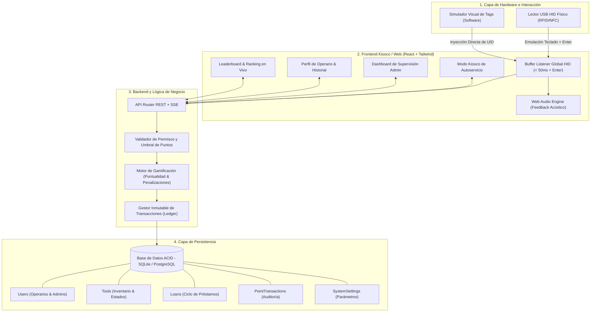
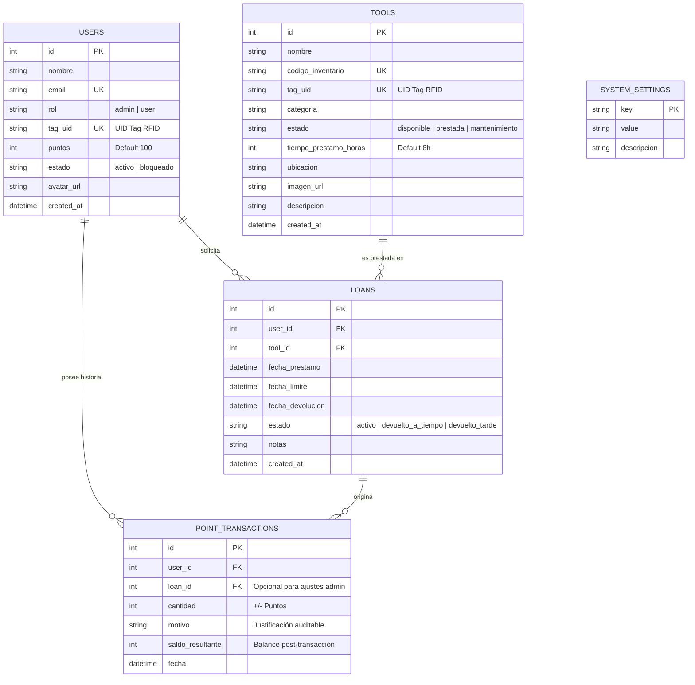

# Arquitectura del Sistema - ToolTag Pro
**Sistema Integral de Gestión de Préstamo de Herramientas mediante RFID/NFC con Motor de Gamificación y Auditoría**

---

## 1. Visión General de la Arquitectura

ToolTag Pro implementa una arquitectura modular de alta disponibilidad orientada a eventos para entornos industriales, talleres mecánicos, laboratorios de electrónica y plantas de manufactura. Permite la identificación instantánea de operarios y herramientas mediante etiquetas físicas RFID/NFC (frecuencias 125 kHz EM4100 / 13.56 MHz Mifare / NFC ISO14443A) o simuladores integrados, procesando reglas automatizadas de control de inventario y gamificación con incentivos por puntualidad.

---

## 2. Diagrama Entidad-Relación (Base de Datos)

El modelo de datos garantiza integridad referencial con claves foráneas activas y un registro de auditoría (*append-only ledger*) para asegurar que cada punto otorgado o deducido tenga trazabilidad completa.

---

## 3. Especificación del Motor de Gamificación

El sistema recompensa la puntualidad en el retorno de equipo y penaliza las demoras de forma proporcional al tiempo de retraso.

### 3.1. Fórmulas de Cálculo

1. **Saldo Inicial**:
   Todo nuevo usuario registrado comienza con un capital base de:
   $$\text{Puntos Iniciales} = 100\text{ pts}$$

2. **Entrega a Tiempo o Anticipada** ($t_{\text{devolución}} \le t_{\text{límite}}$):
   $$\Delta_{\text{puntos}} = +\text{BonoPuntualidad} \quad (\text{por defecto } +10\text{ pts})$$
   $$\text{Estado del Préstamo} = \texttt{devuelto\_a\_tiempo}$$

3. **Entrega Tardía** ($t_{\text{devolución}} > t_{\text{límite}}$):
   $$\Delta t = t_{\text{devolución}} - t_{\text{límite}}$$
   $$\text{HorasRetraso} = \max\left(1, \left\lceil \frac{\Delta t}{3600\text{ s}} \right\rceil\right)$$
   $$\text{Penalización} = \text{PenalizaciónBase} + (\text{HorasRetraso} \times \text{PenalizaciónHoraria})$$
   $$\Delta_{\text{puntos}} = -\text{Penalización} \quad (\text{ej: } -[15 + 2 \times 5] = -25\text{ pts})$$
   $$\text{Estado del Préstamo} = \texttt{devuelto\_tarde}$$

4. **Actualización del Saldo del Usuario**:
   $$\text{Puntos}_{\text{nuevo}} = \max\left(0, \text{Puntos}_{\text{anterior}} + \Delta_{\text{puntos}}\right)$$

### 3.2. Umbral de Seguridad y Bloqueo de Préstamos
Si un operario acumula retrasos continuos y su puntaje cae por debajo del umbral mínimo:
$$\text{Puntos} < \text{UmbralMínimo} \quad (\text{ej: } < 20\text{ pts})$$
El sistema Kiosco:
- **Bloquea** la pestaña de Check-out (no permite retirar nuevas herramientas).
- **Mantiene abierta** la pestaña de Check-in para que el operario pueda devolver sus herramientas pendientes y recuperar puntos.
- Muestra una alerta visual en rojo indicando el motivo exacto del bloqueo.

### 3.3. Tiers y Niveles de Operario (Leaderboard)
- **💎 Nivel Diamante**: $\ge 130$ puntos (Operario Modelo / Prioridad en herramientas críticas).
- **🥇 Nivel Oro**: $110 - 129$ puntos (Excelente puntualidad).
- **🥈 Nivel Plata**: $90 - 109$ puntos (Cumplimiento estándar).
- **🥉 Nivel Bronce**: $50 - 89$ puntos (Requiere atención).
- **⚠️ En Riesgo**: $< 50$ puntos (Alerta preventiva antes de bloqueo).

---

## 4. Protocolo de Integración para Lectores USB HID (RFID/NFC)

### 4.1. Comportamiento Físico del Hardware
La gran mayoría de los lectores RFID y NFC de escritorio (como Sycreader USB, RC522 USB, PN532 HID, o lectores de códigos de barras industriales) se identifican ante el sistema operativo como un **dispositivo de interfaz humana (USB HID Keyboard)**.

Al acercar una tarjeta o tag:
1. El microcontrolador del lector lee el UID del transponder (ej: `E20000192809` o `USR-001-A`).
2. Transmite cada caracter del UID a través de paquetes de teclado a una velocidad de ráfaga muy alta (intervalo entre teclas $\le 25\text{ ms}$).
3. Envía un caracter delimitador final, que por estándar es `Enter` (`\r` o `\n` o código ASCII 13).

### 4.2. Algoritmo de Detección en Frontend (`app.js`)
Para no obligar al operario a hacer clic en una caja de texto antes de acercar su credencial, ToolTag Pro implementa un **Listener Global de Ráfagas**:
- Monitorea el evento `window.addEventListener('keydown', ...)`.
- Mide el diferencial de tiempo entre caracteres ($\Delta t_{\text{tecla}}$). Si $\Delta t > 120\text{ ms}$, descarta el buffer por considerarlo tecleo manual humano lento.
- Al recibir `Enter`, si la longitud del buffer es $\ge 3$ caracteres, lo procesa inmediatamente como lectura de Tag RFID.
- Realiza una consulta contextual a `/api/rfid/scan`:
  - Si el UID pertenece a un **Usuario**, inicia sesión inmediatamente en el Kiosco.
  - Si el UID pertenece a una **Herramienta** y el usuario ya está en el Kiosco:
    - Si ya tiene la herramienta prestada $\to$ **Ejecuta Check-in (devolución inmediata)**.
    - Si está disponible $\to$ **Ejecuta Check-out (préstamo inmediato)**.

---

## 5. Catálogo de Endpoints REST & SSE

| Método | Endpoint | Descripción |
|---|---|---|
| `GET` | `/api/health` | Verificación de estado de la aplicación. |
| `GET` | `/api/stats` | Métricas globales (herramientas, préstamos activos, vencidos, usuarios). |
| `POST` | `/api/rfid/scan` | Procesador inteligente de Tag UID (identifica si es usuario o herramienta). |
| `GET` | `/api/users` | Lista de todos los operarios con estado y préstamos activos. |
| `POST` | `/api/users` | Registrar nuevo operario con UID de tag físico. |
| `GET` | `/api/users/by-tag/{tag_uid}` | Búsqueda ultrarrápida de usuario mediante RFID. |
| `GET` | `/api/tools` | Catálogo de herramientas con filtros por categoría y estado. |
| `POST` | `/api/tools` | Alta de herramienta vinculando UID de Tag RFID. |
| `POST` | `/api/loans/checkout` | Registro de préstamo con cálculo automático de fecha límite. |
| `POST` | `/api/loans/checkin` | Registro de devolución con cálculo automático de bonos/penalizaciones. |
| `POST` | `/api/points/adjust` | Ajuste manual de puntos por Administrador con justificación en Ledger. |
| `GET` | `/api/leaderboard` | Tabla de clasificación en tiempo real ordenada por puntos y puntualidad. |
| `GET` | `/api/transactions` | Historial completo de auditoría de transacciones de puntos. |
| `GET` | `/api/settings` | Obtención de parámetros de gamificación y umbrales. |
| `PUT` | `/api/settings` | Actualización de reglas de gamificación en caliente. |
| `POST` | `/api/seed/reset` | Reinicio de base de datos a los datos de prueba oficiales. |
| `GET` | `/api/events` | Canal Server-Sent Events (SSE) para sincronización en tiempo real. |
